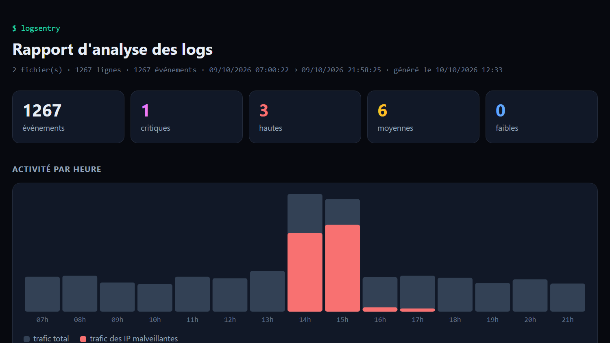
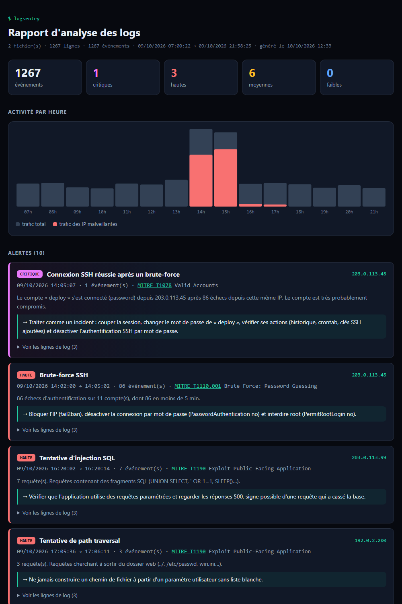

# logsentry

Un **mini SIEM** en ligne de commande, écrit en **Go** sans aucune dépendance externe.

`logsentry` lit les logs d'un serveur Linux : connexions SSH (`auth.log`) et accès web (Nginx / Apache). Il y **détecte les attaques**, puis les classe par **gravité**, avec la technique **MITRE ATT&CK** correspondante et une recommandation de réponse.



## 🔴 Essayer en ligne

**[portfolio-ten-khaki-63.vercel.app/lab/logsentry](https://portfolio-ten-khaki-63.vercel.app/lab/logsentry/)**

Déposez vos propres `auth.log` ou `access.log`, ou cliquez sur « Essayer avec des logs de démo ». Le même code Go est compilé en **WebAssembly** et tourne **dans votre navigateur**, donc vos logs ne quittent jamais votre ordinateur. La page applique une Content-Security-Policy stricte :

- `connect-src 'self'` : aucune connexion possible vers un autre site ;
- `'wasm-unsafe-eval'` : autorise uniquement l'exécution du WebAssembly, et pas `eval` en JavaScript ;
- le rapport s'affiche dans une iframe `sandbox` sans scripts.

Pour reconstruire la version web :

```bash
sh web/build.sh   # compile web/logsentry.wasm et copie les fichiers nécessaires
```

## Exemple

```
$ logsentry /var/log/auth.log /var/log/nginx/access.log

logsentry 2 fichier(s) · 1267 lignes · 1267 événements analysés
période : 09/10 07:00:22 → 09/10 21:58:25

Alertes : 1 critique(s) · 3 haute(s) · 6 moyenne(s) · 0 faible(s)

[CRITIQUE] Connexion SSH réussie après un brute-force — 203.0.113.45
  09/10 14:05:07 · 1 événement(s) · MITRE T1078 Valid Accounts
  Le compte « deploy » s'est connecté (password) depuis 203.0.113.45 après 86 échecs
  depuis cette même IP. Le compte est très probablement compromis.
  → Traiter comme un incident : couper la session, changer le mot de passe de « deploy »,
    vérifier ses actions (historique, crontab, clés SSH ajoutées) et désactiver
    l'authentification SSH par mot de passe.

[HAUTE] Brute-force SSH — 203.0.113.45
  09/10 14:02:00 → 14:05:02 · 86 événement(s) · MITRE T1110.001 Brute Force: Password Guessing
  86 échecs d'authentification sur 11 compte(s), dont 86 en moins de 5 min.
  ...

IP les plus dangereuses
  203.0.113.45     critique   3 alerte(s), 151 événement(s)  SSH-COMPROMISE, SSH-BRUTEFORCE, SSH-ENUM
  203.0.113.99     haute      2 alerte(s), 8 événement(s)    WEB-SQLI, WEB-TOOL
  ...
```

## Règles de détection

| Règle | Sévérité | Ce qui est détecté | MITRE ATT&CK |
|---|---|---|---|
| `SSH-COMPROMISE` | **critique** | Connexion SSH **réussie** depuis une IP qui vient de faire du brute-force | [T1078](https://attack.mitre.org/techniques/T1078/) Valid Accounts |
| `SSH-BRUTEFORCE` | haute | ≥ 10 échecs SSH en 5 minutes (fenêtre glissante) | [T1110.001](https://attack.mitre.org/techniques/T1110/001/) Password Guessing |
| `SSH-ENUM` | moyenne | ≥ 5 comptes inexistants essayés par la même IP | [T1110](https://attack.mitre.org/techniques/T1110/) Brute Force |
| `WEB-SQLI` | haute | `UNION SELECT`, `' OR 1=1`, `SLEEP()`, `information_schema`… | [T1190](https://attack.mitre.org/techniques/T1190/) Exploit Public-Facing App |
| `WEB-TRAVERSAL` | haute | `../`, `/etc/passwd`, `win.ini`… | T1190 |
| `WEB-XSS` | moyenne | `<script>`, `onerror=`, `document.cookie`… | T1190 |
| `WEB-SCAN` | moyenne | ≥ 30 réponses 404 en 5 minutes (scan de répertoires) | [T1595.003](https://attack.mitre.org/techniques/T1595/003/) Wordlist Scanning |
| `WEB-SENSITIVE` | moyenne | Accès à `.env`, `.git/`, sauvegardes SQL, clés AWS… | T1595.003 |
| `WEB-TOOL` | moyenne | User-Agent d'outils connus : sqlmap, nikto, gobuster, nmap, wpscan… | [T1595](https://attack.mitre.org/techniques/T1595/) Active Scanning |

Quelques choix pour limiter les **faux positifs** :

- Le brute-force utilise une **fenêtre glissante**. Un utilisateur qui se trompe 3 fois, ou 12 fois étalées sur une journée, ne déclenche rien.
- Les URL sont **décodées deux fois** avant l'analyse. Les attaquants encodent souvent deux fois (`%2527` → `%27` → `'`) pour contourner les filtres naïfs.
- Les motifs SQL exigent une vraie syntaxe. Une URL comme `/blog/union-europeenne-et-select-committee` ou un nom comme « O'Neil » ne déclenche pas d'alerte.
- Les tests vérifient chacun de ces cas.

## Tableau de bord HTML

```bash
logsentry -html rapport.html /var/log/auth.log /var/log/nginx/access.log
```

Le rapport tient dans un seul fichier, sans JavaScript ni dépendance. Il contient :

- une chronologie par heure, avec le trafic malveillant en rouge ;
- les alertes avec leurs preuves (les lignes de log exactes) ;
- les liens vers MITRE ATT&CK ;
- la liste des IP attaquantes.

Les logs contiennent des données contrôlées par l'attaquant : le rapport les **échappe systématiquement**, pour ne pas devenir lui-même vulnérable au XSS. Un test le vérifie.



## Installation et utilisation

Prérequis : [Go 1.22+](https://go.dev/dl/).

```bash
go install github.com/yaniscalo36-commits/logsentry@latest
```

```bash
logsentry testdata/auth.log testdata/access.log         # démo incluse
logsentry -html rapport.html /var/log/auth.log           # tableau de bord
logsentry -json /var/log/nginx/access.log                # sortie JSON (pour un autre outil)
logsentry -min-severity haute /var/log/auth.log          # n'afficher que haute et critique
logsentry -fail-on critique /var/log/auth.log            # code de sortie 2 si incident critique
```

| Option | Rôle | Défaut |
|---|---|---|
| `-html fichier` | Écrit le tableau de bord HTML | |
| `-json` | Sortie JSON complète | |
| `-min-severity` | Filtre l'affichage (`faible`, `moyenne`, `haute`, `critique`) | `faible` |
| `-fail-on` | Code de sortie 2 si une alerte atteint ce niveau (cron, CI) | |
| `-bf-threshold` / `-bf-window` | Seuil et fenêtre du brute-force SSH | `10` / `5m` |
| `-scan-threshold` | Nombre de 404 pour déclarer un scan | `30` |

### Surveillance automatique (cron)

```bash
# Toutes les heures : rapport HTML, et alerte par mail si un incident critique est détecté
0 * * * * logsentry -html /var/www/rapport.html -fail-on critique /var/log/auth.log || mail -s "Incident SSH" admin@exemple.fr < /dev/null
```

## Données de démonstration

Le dossier `testdata/` contient des logs générés par `go run testdata/generate.go`. Ils racontent une journée réaliste sur un serveur :

| Heure | Événement | Résultat attendu |
|---|---|---|
| Toute la journée | ~900 visites légitimes, connexions SSH par clé | Aucune alerte |
| 10h15 | « marie » se trompe 3 fois de mot de passe puis se connecte | Aucune alerte |
| 14h02 | Brute-force SSH de 86 tentatives sur 11 comptes… | Brute-force + énumération |
| 14h05 | … puis **connexion réussie** sur le compte `deploy` | **Alerte critique** |
| 15h10 | Scan de répertoires avec gobuster (167 requêtes en 56 s) | Scan + outil + fichiers sensibles |
| 16h20 | Injection SQL avec sqlmap | Injection SQL + outil |
| 17h05 | Tentatives de XSS et de path traversal | XSS + path traversal |

Les adresses IP utilisées sont **réservées à la documentation** ([RFC 5737](https://www.rfc-editor.org/rfc/rfc5737)) et n'appartiennent à personne.

## Tests

```bash
go test ./...
```

Les tests couvrent la lecture des différents formats de logs, chaque règle de détection, les faux positifs, le scénario de démonstration complet et l'échappement du rapport HTML.

## Organisation Git

- `main` : version stable
- `develop` : intégration
- `feature/parsers`, `feature/detection`, `feature/reports`, `feature/wasm`, `docs/readme` : une branche par fonctionnalité

---

Projet personnel de [Yanis Calonge](https://portfolio-ten-khaki-63.vercel.app), étudiant en Bachelor Cybersécurité à Ynov Toulouse.
